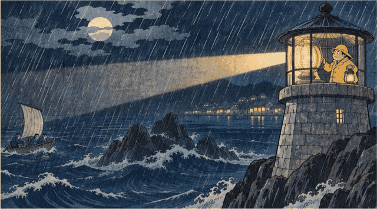
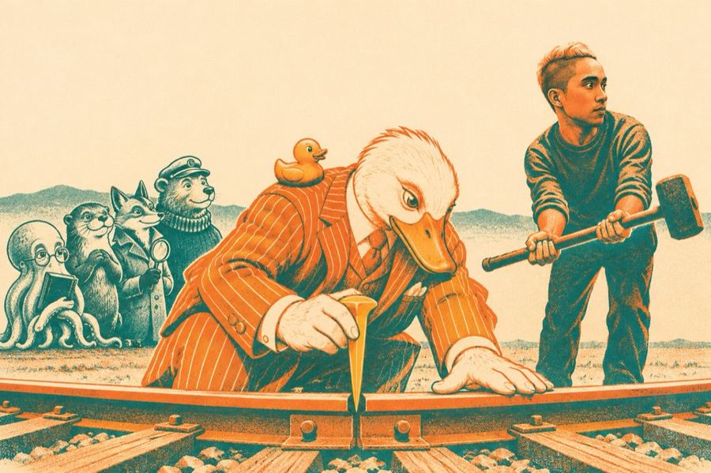
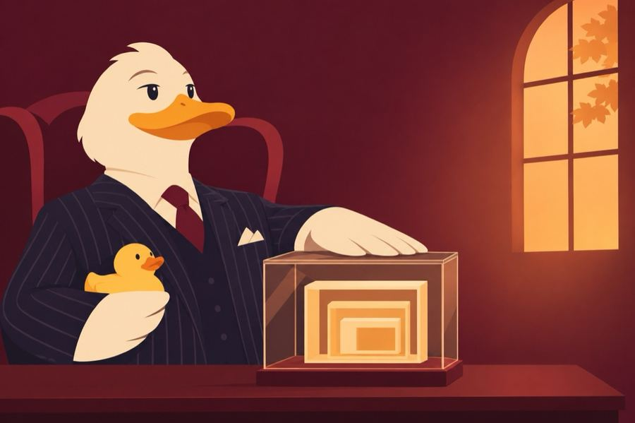
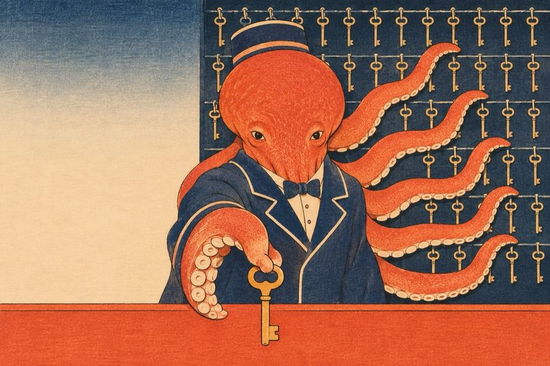
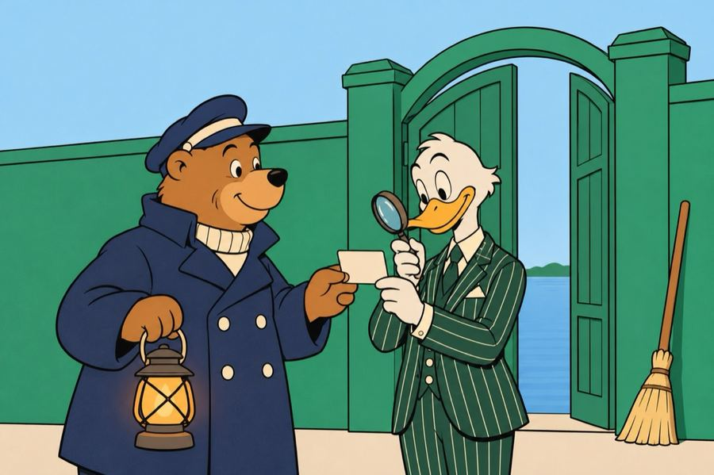
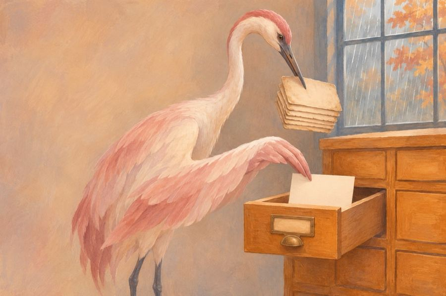
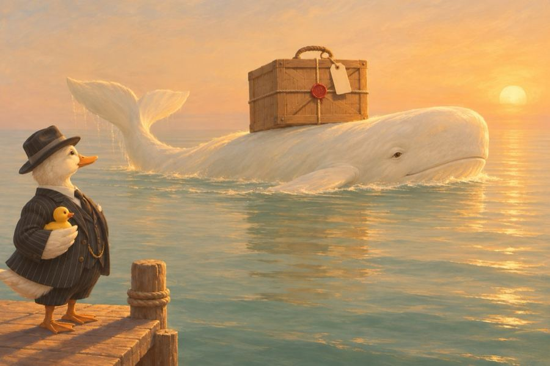
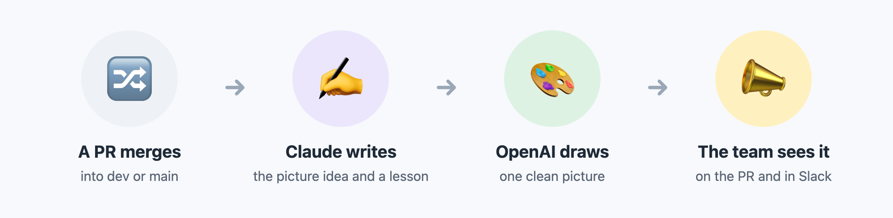
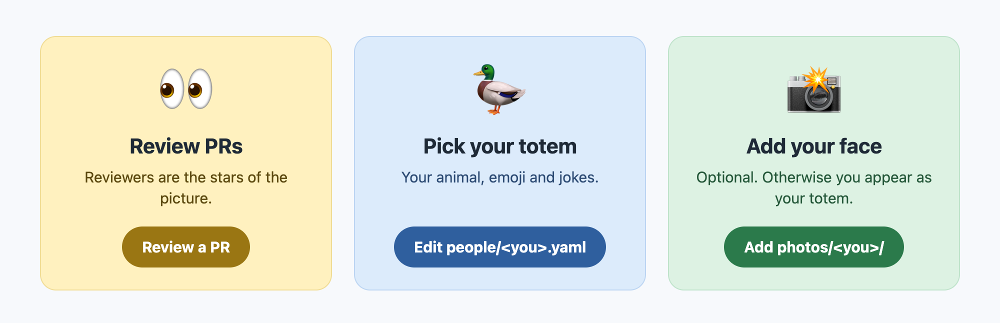
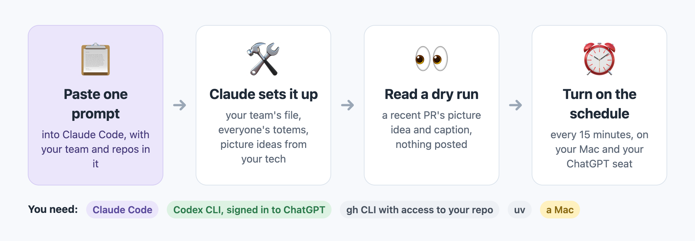

# 🔦 pr-spotlight

Every merged PR gets a comment with a picture of the people behind it and a short lesson from its diff. Reviewers are the stars: their time on other people's work usually goes unseen.



See it in a picture-book deck: [PR Spotlight](https://ngnnah.github.io/I-And-AI/projects/pr-spotlight/). MIT licensed.

<table>
<tr>
<td width="33%"><br>Risograph: the duck drives the spike</td>
<td width="33%"><br>Flat editorial: the Don seals the index</td>
<td width="33%"><br>Ukiyo-e: one key, one room</td>
</tr>
<tr>
<td><br>Ligne claire: one pass at the gate</td>
<td><br>Painted storybook: the crane clears the drawer</td>
<td><br>Siesta light: one sealed crate sets sail</td>
</tr>
</table>

## How it works



1. A PR merges. `gh` gathers its diff, its reviews and who took part. On a release (dev → main), the reviewers star; on a feature PR, the opener does, with the reviewers in about half the pictures.
2. Claude writes the picture idea and the caption: what the PR did, a thanks to the reviewers, a lesson and a tip. The idea draws on the diff (`map.yaml` turns tech terms into picture ideas) and on the least-used of 261 art styles (`styles.yaml`).
3. OpenAI's image model draws it, through the Codex CLI signed in to a ChatGPT plan. No API key.
4. The image is committed to your copy of this repo, the caption and image go on the PR as a comment, and an optional one-line post goes to Slack, through Claude Code's Slack connector.

A job on a Mac runs this every 15 minutes, at most three PRs a run. Spotlights wait for a person to post them until you turn on `auto_post`.

## Faces are opt-in



Everyone starts as an animal totem from `people/<login>.yaml`. A teammate is drawn from their photos only when they've said yes and their file has `likeness: yes`. Photos go to the image model only for those people.

## Set it up for your team



You need a Mac, [Claude Code](https://claude.com/claude-code), the [Codex CLI](https://github.com/openai/codex) signed in to ChatGPT, the [gh CLI](https://cli.github.com/) and [uv](https://docs.astral.sh/uv/).

1. Use this repo as a template, or fork it, into your own org. Keep it private if your PRs are: comments link to images stored here.
2. Paste this into Claude Code in your copy:

```text
Set up PR spotlights for my team in this repo.
My team: <team name>. Our repos: <owner/repo>, <owner/repo>. Slack channel for the posts: <#channel, or none>.

1. Copy teams/example.yaml to teams/<team>.yaml: our repos, start set to now, auto_post: false, our Slack channel's id or "".
2. For everyone who opened or reviewed a PR in our repos in the last 90 days, draft people/<login>.yaml in the shape of people/octocat.yaml: a kind animal totem from their work, likeness: no, photos: []. Then delete teams/example.yaml and people/octocat.yaml.
3. Add map.yaml entries for our own stack, from our repos' languages, dependencies and recent PRs.
4. Check that gh, claude and codex are signed in. Run ./spotlight.py run <repo>#<a recent merged PR> --dry-run and show me the picture idea and the caption. Post nothing.
5. When I say go, run ./spotlight.py install. It renders every 15 minutes on this Mac and holds each spotlight until I post it with ./spotlight.py post <repo>#<pr>.
```

## Commands

```text
./spotlight.py run <repo>#<pr> [--dry-run] [--no-post]   brief, render and post one spotlight
./spotlight.py post <repo>#<pr>                          post one rendered with --no-post
./spotlight.py poll                                      PRs merged since the team's start, three at most
./spotlight.py install                                   the launchd job: poll every 15 minutes
./gif.py <repo>#<pr>                                     a looping four-frame GIF in place of the still
```

`--team <team>` picks a team file when there's more than one.

## Cost

Each picture uses about 1% of a ChatGPT plan's 5-hour Codex window and takes about two minutes.
